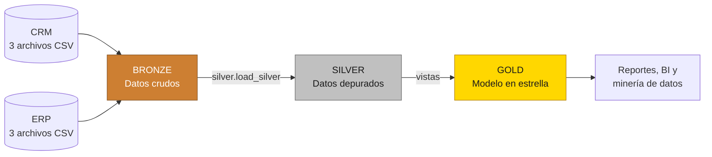

# Data Warehouse en SQL Server con Arquitectura Medallion

**Autores:** José Julián Pérez Bustamante
**Asignatura:** Ingeniería y Minería de Datos

Proyecto de ingeniería de datos que construye, desde cero, un almacén de datos
(*Data Warehouse*) en **SQL Server**. El sistema consolida la información de
ventas proveniente de dos sistemas fuente (CRM y ERP) mediante procesos ETL
organizados en la arquitectura **Medallion** (Bronze, Silver y Gold) y expone
un **modelo en estrella** listo para el análisis y la minería de datos.

> Este repositorio es una réplica paso a paso, adaptada y documentada en
> español, del proyecto *"SQL Data Warehouse from Scratch"* de
> [DataWithBaraa](https://github.com/DataWithBaraa/sql-data-warehouse-project).
> Los nombres de esquemas, tablas y columnas se conservan en inglés para
> mantener la compatibilidad con los datos de origen.

---

## Arquitectura de datos



| Capa       | Propósito                                                                 | Objetos                                   |
|------------|---------------------------------------------------------------------------|-------------------------------------------|
| **Bronze** | Almacenar los datos crudos tal como llegan desde los archivos CSV.        | 6 tablas cargadas con `BULK INSERT`.      |
| **Silver** | Limpiar, estandarizar, normalizar y enriquecer los datos.                 | 6 tablas con columna de auditoría `dwh_create_date`. |
| **Gold**   | Integrar las fuentes en un modelo en estrella orientado al negocio.       | 2 dimensiones y 1 tabla de hechos (vistas). |

La arquitectura detallada, el linaje de los datos, el modelo de integración y
el diagrama entidad-relación se documentan en
[docs/data_architecture.md](docs/data_architecture.md).

---

## Requerimientos del proyecto

### Ingeniería de datos: construcción del almacén

**Objetivo:** desarrollar un almacén de datos moderno en SQL Server que
consolide los datos de ventas y habilite reportes analíticos y la toma de
decisiones informada.

- **Fuentes de datos:** importar los datos de dos sistemas fuente (ERP y CRM)
  entregados como archivos CSV.
- **Calidad de los datos:** depurar y resolver los problemas de calidad antes
  del análisis.
- **Integración:** combinar ambas fuentes en un único modelo de datos,
  intuitivo y diseñado para consultas analíticas.
- **Alcance:** trabajar únicamente con el conjunto de datos más reciente; no
  se requiere historización.
- **Documentación:** proporcionar documentación clara del modelo de datos para
  usuarios de negocio y equipos analíticos.

### Análisis de datos: inteligencia de negocio

**Objetivo:** desarrollar consultas analíticas en SQL que generen información
sobre:

- el **comportamiento de los clientes**,
- el **desempeño de los productos**, y
- las **tendencias de ventas**.

---

## Fuentes de datos

| Sistema | Archivo             | Tabla Bronze               | Contenido                               | Registros |
|---------|---------------------|----------------------------|-----------------------------------------|----------:|
| CRM     | `cust_info.csv`     | `bronze.crm_cust_info`     | Información maestra de clientes         | 18 494    |
| CRM     | `prd_info.csv`      | `bronze.crm_prd_info`      | Catálogo histórico de productos         | 397       |
| CRM     | `sales_details.csv` | `bronze.crm_sales_details` | Transacciones de venta                  | 60 398    |
| ERP     | `CUST_AZ12.csv`     | `bronze.erp_cust_az12`     | Datos demográficos de clientes          | 18 484    |
| ERP     | `LOC_A101.csv`      | `bronze.erp_loc_a101`      | Ubicación (país) de los clientes        | 18 484    |
| ERP     | `PX_CAT_G1V2.csv`   | `bronze.erp_px_cat_g1v2`   | Categorías y subcategorías de productos | 37        |

---

## Estructura del repositorio

```
sql-data-warehouse-project/
├── datasets/
│   ├── source_crm/                  # Archivos CSV del sistema CRM
│   └── source_erp/                  # Archivos CSV del sistema ERP
├── docs/
│   ├── data_architecture.md         # Arquitectura, linaje y modelo en estrella (Mermaid)
│   ├── data_catalog.md              # Catálogo de datos de la capa Gold
│   └── naming_conventions.md        # Convenciones de nombres
├── scripts/
│   ├── init_database.sql            # Creación de la base de datos y esquemas
│   ├── bronze/
│   │   ├── ddl_bronze.sql           # DDL de las tablas Bronze
│   │   └── proc_load_bronze.sql     # Procedimiento bronze.load_bronze
│   ├── silver/
│   │   ├── ddl_silver.sql           # DDL de las tablas Silver
│   │   └── proc_load_silver.sql     # Procedimiento silver.load_silver
│   └── gold/
│       └── ddl_gold.sql             # Vistas del modelo en estrella
├── tests/
│   ├── quality_checks_silver.sql    # Controles de calidad de la capa Silver
│   └── quality_checks_gold.sql      # Controles de calidad de la capa Gold
├── LICENSE
└── README.md
```

---

## Requisitos técnicos

- **SQL Server** 2019 o superior (Express, Developer o contenedor Docker).
- **SQL Server Management Studio (SSMS)**, Azure Data Studio o la extensión
  *SQL Server (mssql)* de VS Code para ejecutar los scripts.
- **Git** para el control de versiones.

### Ejecución en macOS mediante Docker (opcional)

SQL Server no se instala de forma nativa en macOS, pero puede ejecutarse en un
contenedor. En SQL Server sobre Linux, la ruta `C:\sql\dwh_project\datasets\`
utilizada por `BULK INSERT` se traduce a `/sql/dwh_project/datasets/`.

```bash
# 1. Iniciar SQL Server 2022 (sustituya la contraseña por una propia)
docker run -d --name sql-dwh --platform linux/amd64 \
  -e "ACCEPT_EULA=Y" -e "MSSQL_SA_PASSWORD=<ContraseñaSegura>" \
  -p 1433:1433 mcr.microsoft.com/mssql/server:2022-latest

# 2. Copiar los datasets a la ruta esperada por bronze.load_bronze
docker exec -u 0 sql-dwh mkdir -p /sql/dwh_project
docker cp datasets sql-dwh:/sql/dwh_project/datasets
```

Luego conéctese a `localhost,1433` con el usuario `sa` desde el cliente SQL de
su preferencia.

---

## Guía de ejecución

Ejecute los scripts en el siguiente orden:

1. `scripts/init_database.sql` — crea la base de datos `DataWarehouse` y los
   esquemas `bronze`, `silver` y `gold`.
2. `scripts/bronze/ddl_bronze.sql` — crea las tablas de la capa Bronze.
3. `scripts/bronze/proc_load_bronze.sql` — crea el procedimiento de carga.
   *Ajuste previamente las rutas de `BULK INSERT` a la ubicación de sus CSV.*
4. Cargue la capa Bronze:
   ```sql
   EXEC bronze.load_bronze;
   ```
5. `scripts/silver/ddl_silver.sql` — crea las tablas de la capa Silver.
6. `scripts/silver/proc_load_silver.sql` — crea el procedimiento ETL.
7. Cargue la capa Silver:
   ```sql
   EXEC silver.load_silver;
   ```
8. `scripts/gold/ddl_gold.sql` — crea las vistas del modelo en estrella.
9. `tests/quality_checks_silver.sql` y `tests/quality_checks_gold.sql` —
   validan la calidad de los datos. Las consultas marcadas con
   *"Resultado esperado: sin registros"* no deben devolver filas.

### Ejemplo de consulta analítica

```sql
-- Ventas totales por país y categoría de producto
SELECT
    c.country,
    p.category,
    SUM(f.sales_amount) AS total_sales,
    COUNT(DISTINCT f.order_number) AS total_orders
FROM gold.fact_sales f
LEFT JOIN gold.dim_customers c ON f.customer_key = c.customer_key
LEFT JOIN gold.dim_products  p ON f.product_key  = p.product_key
GROUP BY c.country, p.category
ORDER BY total_sales DESC;
```

---

## Principales transformaciones (capa Silver)

| Tabla               | Transformaciones                                                                                              |
|---------------------|---------------------------------------------------------------------------------------------------------------|
| `crm_cust_info`     | `TRIM` de nombres; estado civil → `Single`/`Married`/`n/a`; género → `Female`/`Male`/`n/a`; deduplicación por `cst_id` conservando el registro más reciente. |
| `crm_prd_info`      | Derivación de `cat_id` y `prd_key`; costos nulos → `0`; línea → `Mountain`/`Road`/`Other Sales`/`Touring`/`n/a`; fecha de fin calculada con `LEAD()`. |
| `crm_sales_details` | Fechas enteras `AAAAMMDD` → `DATE` (inválidas → `NULL`); recálculo de ventas y precios inconsistentes.         |
| `erp_cust_az12`     | Eliminación del prefijo `NAS` en `cid`; fechas de nacimiento futuras → `NULL`; normalización del género.     |
| `erp_loc_a101`      | Eliminación de guiones en `cid`; países → `Germany`/`United States`/`n/a`.                                    |
| `erp_px_cat_g1v2`   | Carga directa sin transformaciones.                                                                            |

---

## Documentación

- [Arquitectura de datos](docs/data_architecture.md)
- [Catálogo de datos](docs/data_catalog.md)
- [Convenciones de nombres](docs/naming_conventions.md)

---

## Créditos y licencia

- Proyecto original: **Baraa Khatib Salkini** —
  [DataWithBaraa/sql-data-warehouse-project](https://github.com/DataWithBaraa/sql-data-warehouse-project).
- Adaptación, documentación y comentarios en español:
  **José Julián Pérez Bustamante**.

Distribuido bajo la licencia MIT. Consulte el archivo [LICENSE](LICENSE).
