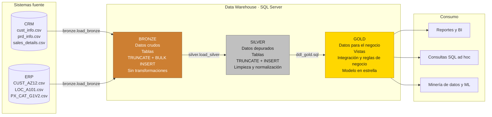
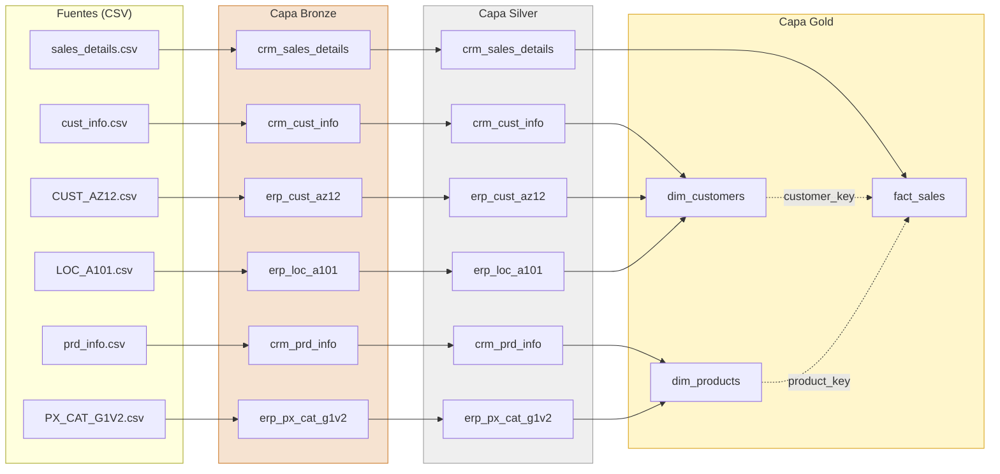
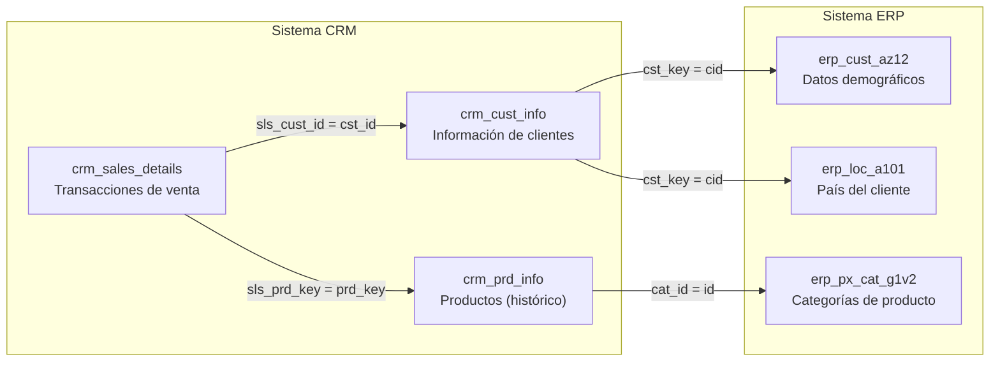
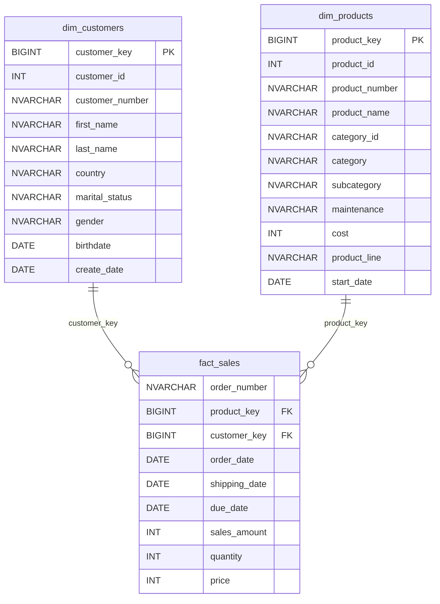

# Arquitectura de Datos

**Autores:** José Julián Pérez Bustamante, Denzel Gael Cruz Prieto, Leonardo de Jesús Esquivel Palacios
**Asignatura:** Ingeniería y Minería de Datos

Este documento describe la arquitectura del almacén de datos, el flujo de los
datos entre capas, la integración de los sistemas fuente y el modelo analítico
final.

## Contenido

1. [Arquitectura Medallion](#1-arquitectura-medallion)
2. [Descripción de las capas](#2-descripción-de-las-capas)
3. [Flujo y linaje de los datos](#3-flujo-y-linaje-de-los-datos)
4. [Modelo de integración de las fuentes](#4-modelo-de-integración-de-las-fuentes)
5. [Modelo en estrella (capa Gold)](#5-modelo-en-estrella-capa-gold)
6. [Orden de ejecución del proceso ETL](#6-orden-de-ejecución-del-proceso-etl)

---

## 1. Arquitectura Medallion

El almacén de datos se implementa en **SQL Server** y adopta la arquitectura
**Medallion**, que organiza los datos en tres capas sucesivas de calidad
creciente: **Bronze**, **Silver** y **Gold**. Cada capa corresponde a un
esquema homónimo dentro de la base de datos `DataWarehouse`.

## 2. Descripción de las capas

| Criterio               | Bronze                                  | Silver                                                  | Gold                                                   |
|------------------------|-----------------------------------------|---------------------------------------------------------|--------------------------------------------------------|
| **Definición**         | Datos crudos, idénticos a la fuente     | Datos depurados y estandarizados                        | Datos listos para el consumo analítico                 |
| **Objetivo**           | Trazabilidad y depuración de errores    | Preparar datos confiables para el modelado              | Responder preguntas de negocio                         |
| **Tipo de objeto**     | Tablas                                  | Tablas                                                  | Vistas                                                 |
| **Método de carga**    | Completa (`TRUNCATE` + `BULK INSERT`)   | Completa (`TRUNCATE` + `INSERT ... SELECT`)             | Sin carga física (vistas)                              |
| **Transformaciones**   | Ninguna                                 | Limpieza, normalización, derivación de columnas, enriquecimiento | Integración de fuentes, agregación, reglas de negocio |
| **Modelado**           | Ninguno (estructura de origen)          | Ninguno (estructura de origen + columnas técnicas)      | Modelo en estrella (dimensiones y hechos)              |
| **Audiencia**          | Ingenieros de datos                     | Ingenieros y analistas de datos                         | Analistas de negocio, usuarios de BI, científicos de datos |

## 3. Flujo y linaje de los datos

El siguiente diagrama muestra el recorrido de cada conjunto de datos desde el
archivo de origen hasta el objeto analítico que lo consume.

## 4. Modelo de integración de las fuentes

Los sistemas CRM y ERP no comparten claves idénticas, por lo que la capa
Silver ajusta los identificadores para que puedan relacionarse.

| Relación                                     | Ajuste aplicado en la capa Silver                                                     |
|----------------------------------------------|---------------------------------------------------------------------------------------|
| `crm_sales_details` → `crm_prd_info`         | `prd_key` se recorta a partir del carácter 7: `SUBSTRING(prd_key, 7, LEN(prd_key))`.  |
| `crm_prd_info` → `erp_px_cat_g1v2`           | `cat_id` se deriva de `prd_key`: `REPLACE(SUBSTRING(prd_key, 1, 5), '-', '_')`.       |
| `crm_cust_info` → `erp_cust_az12`            | Se elimina el prefijo `NAS` de `cid` (p. ej., `NASAW00011000` → `AW00011000`).        |
| `crm_cust_info` → `erp_loc_a101`             | Se eliminan los guiones de `cid` (p. ej., `AW-00011000` → `AW00011000`).              |

## 5. Modelo en estrella (capa Gold)

La capa Gold expone un modelo en estrella compuesto por una tabla de hechos
(`fact_sales`) rodeada por dos dimensiones (`dim_customers` y `dim_products`).
Cada cliente y cada producto pueden participar en cero o muchas ventas, y cada
venta referencia exactamente a un cliente y a un producto.

**Regla de cálculo:** `sales_amount = quantity * price`.

## 6. Orden de ejecución del proceso ETL

| Paso | Script                                   | Acción                                                     |
|------|------------------------------------------|------------------------------------------------------------|
| 1    | `scripts/init_database.sql`              | Crea la base de datos `DataWarehouse` y los tres esquemas. |
| 2    | `scripts/bronze/ddl_bronze.sql`          | Crea las tablas de la capa Bronze.                         |
| 3    | `scripts/bronze/proc_load_bronze.sql`    | Crea el procedimiento `bronze.load_bronze`.                |
| 4    | `EXEC bronze.load_bronze;`               | Carga los CSV en la capa Bronze.                           |
| 5    | `scripts/silver/ddl_silver.sql`          | Crea las tablas de la capa Silver.                         |
| 6    | `scripts/silver/proc_load_silver.sql`    | Crea el procedimiento `silver.load_silver`.                |
| 7    | `EXEC silver.load_silver;`               | Transforma y carga los datos en la capa Silver.            |
| 8    | `scripts/gold/ddl_gold.sql`              | Crea las vistas del modelo en estrella.                    |
| 9    | `tests/quality_checks_silver.sql`        | Valida la calidad de la capa Silver.                       |
| 10   | `tests/quality_checks_gold.sql`          | Valida la integridad del modelo Gold.                      |
